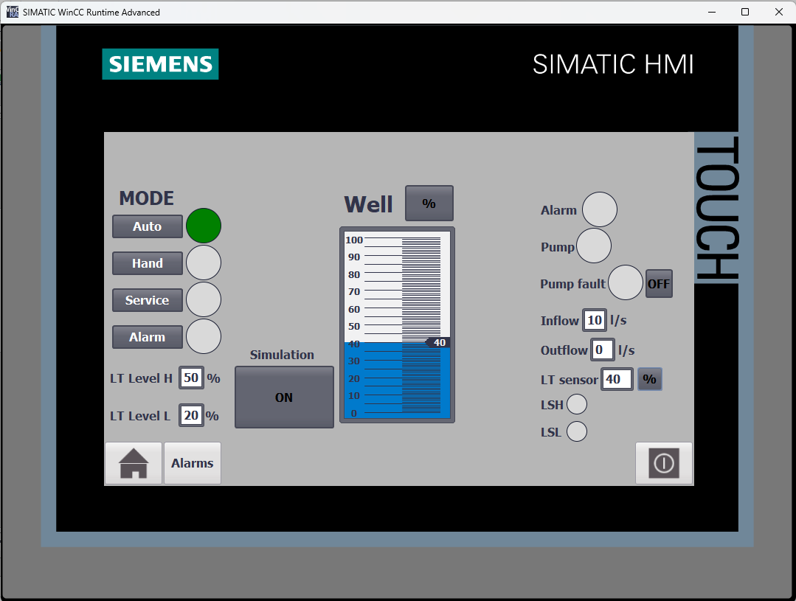
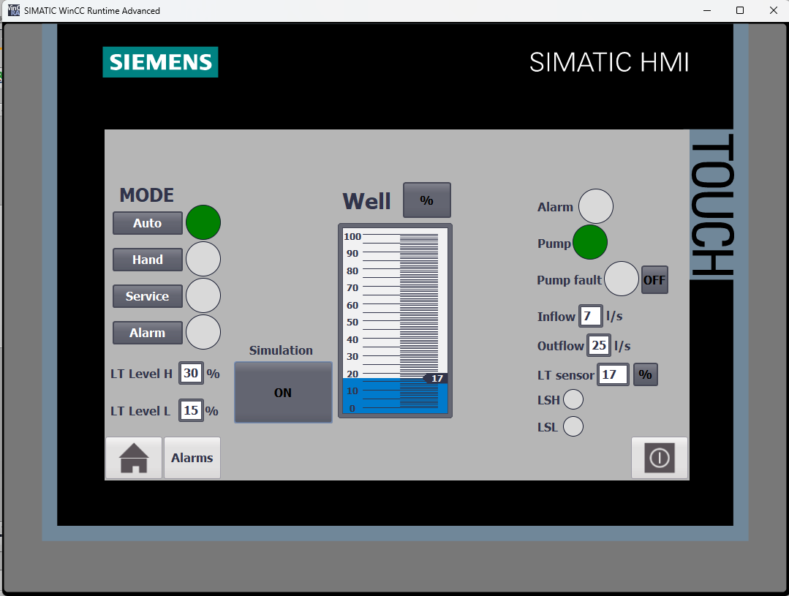
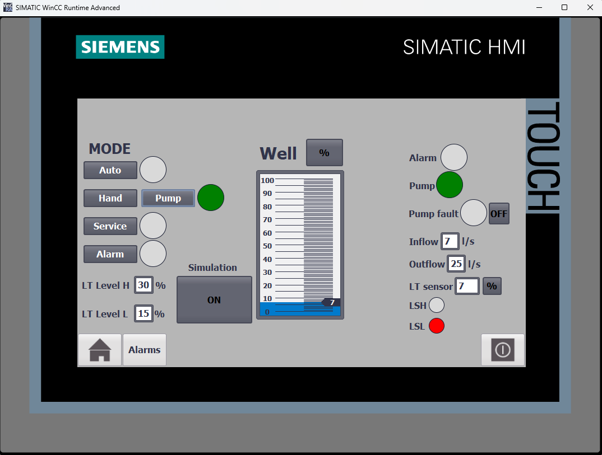
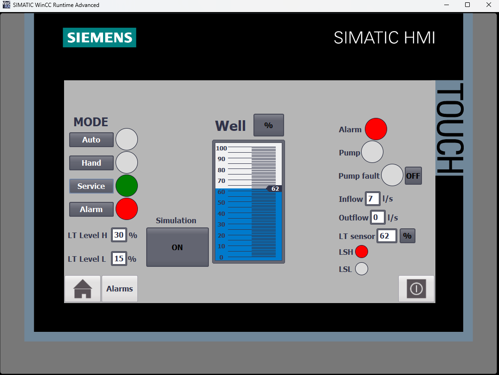
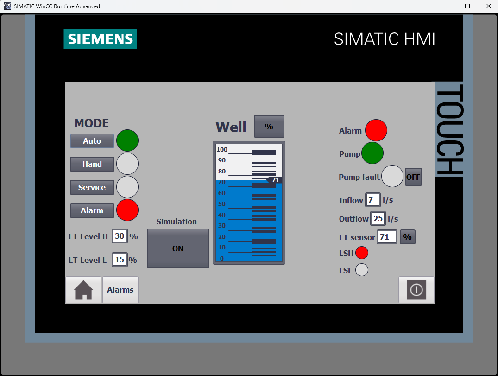
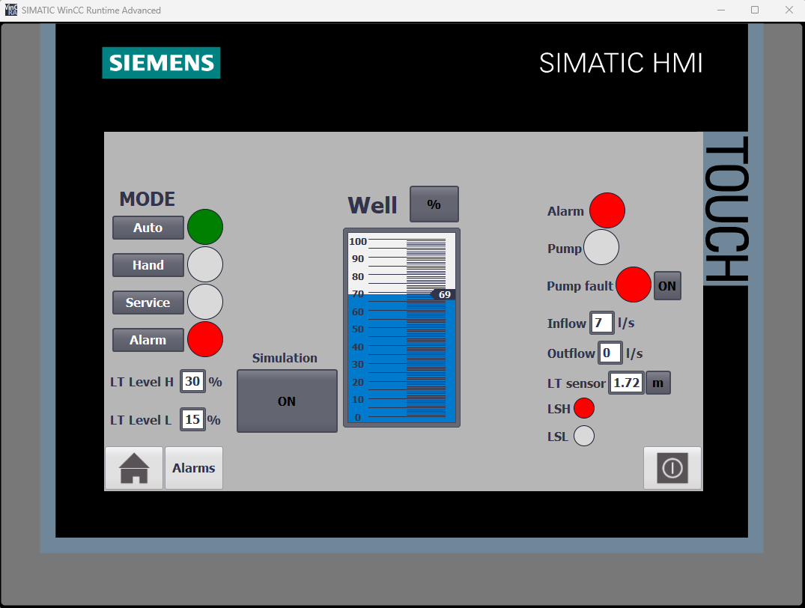
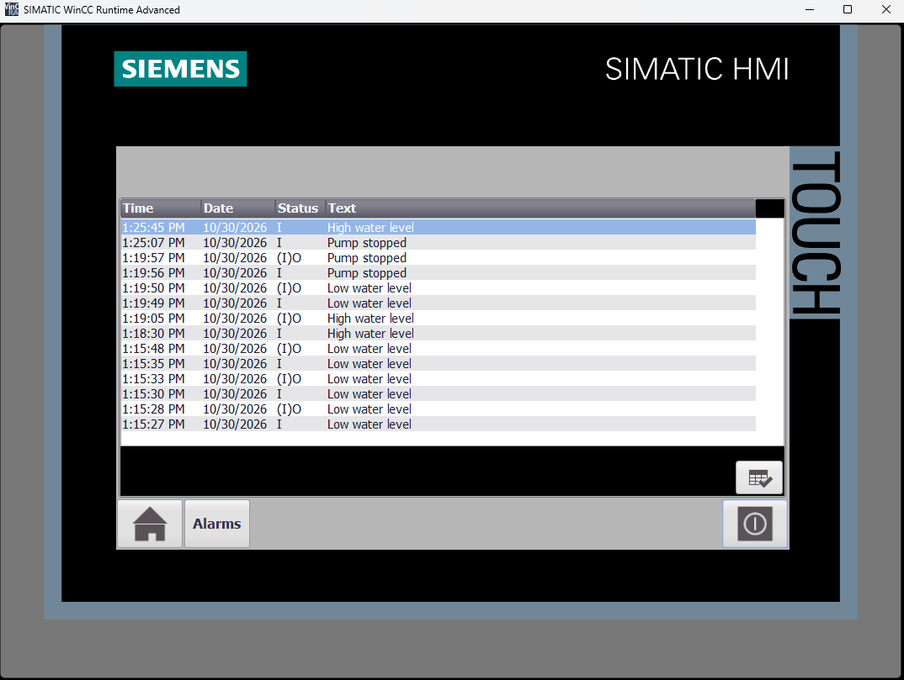
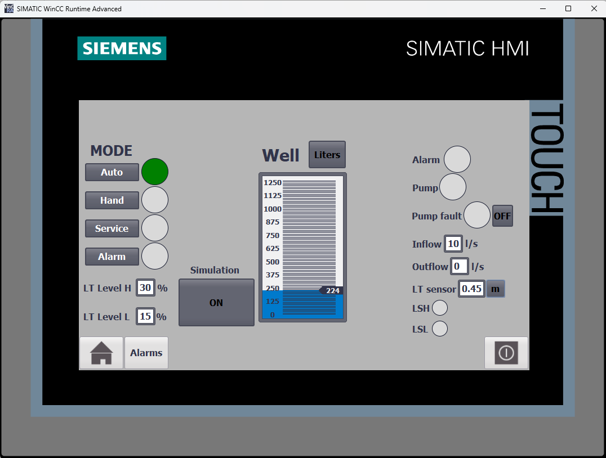
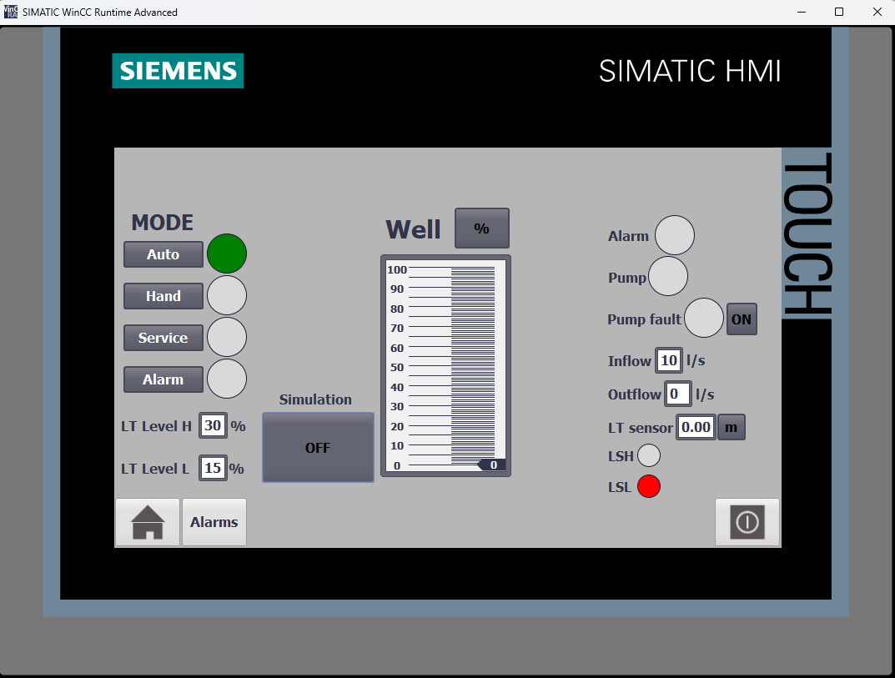
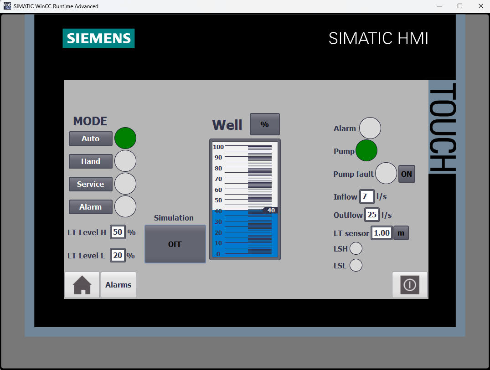

# S7-1200 Single Pump Station

Single pump station control system developed in Siemens TIA Portal V17 using an S7-1200 PLC and WinCC HMI.

The project simulates a water pumping process with automatic and manual operation, adjustable level thresholds, alarm handling and pump fault simulation.

## Features

- Automatic pump control based on water level
- Manual pump operation with override function
- Service mode
- Adjustable upper and lower level thresholds
- High-level alarm with automatic pump activation
- Pump fault simulation
- Continuous water level monitoring
- Tank level visualization in percentages and liters
- Level sensor visualization in percentages and meters
- Inflow and outflow monitoring
- HMI alarm history
- Simulation and physical input operation

## Control System

The process consists of a simulated water tank and pump.

In AUTO mode, the pump starts when the water level reaches the upper threshold (LT Level H) and stops at the lower threshold (LT Level L).

In MANUAL mode, the operator controls the pump directly. An override function allows pump operation below the lower alarm level.

SERVICE mode disables pump operation regardless of the water level.

The system includes two additional alarm thresholds:

- LSH: 60%
- LSL: 10%

In AUTO mode, reaching LSH activates the high-level alarm and the pump continues operating until the water level reaches LSL.

## Pump Fault Simulation

A pump failure can be activated from the HMI.

When the fault is active, pump operation is blocked and the corresponding alarm is displayed.

## HMI

The WinCC HMI provides:

- AUTO / HAND / SERVICE mode selection
- Pump control and status indication
- Adjustable level thresholds
- Tank level visualization
- Inflow and outflow monitoring
- Level sensor monitoring
- Pump fault simulation
- High and low level indications
- Simulation ON / OFF
- Alarm history and status display

## Automatic Control

### Tank Filling

The water level increases while the pump remains inactive.



### Pump Operation

The pump starts automatically after reaching the upper level threshold.


### Level Setpoints

The upper and lower pump control thresholds can be adjusted from the HMI.



## Operating Modes

### Manual Mode

Manual pump control with an override function.



### Service Mode

Pump operation is disabled during maintenance.



## Alarm System

### High Level Alarm

In AUTO mode, reaching LSH activates the alarm and starts the pump until LSL is reached.



### Pump Fault



### Alarm History



## Additional Functions

### Level Units

Tank level can be displayed in percentages or liters, while the level sensor can be displayed in percentages or meters.



### Physical Inputs

With simulation disabled, the system uses physical push buttons and a potentiometer connected to the PLC analog input.



### Process Operation



## Project Structure

```text
S7-1200-Single-Pump-Station/
├── Documentation/
│   └── PLC_Program.pdf
├── Screenshots/
│   ├── 01_Auto_Mode_Filling.png
│   ├── 02_Auto_Mode_Pump_Running.png
│   ├── 03_Level_Setpoints.png
│   ├── 04_Manual_Mode.png
│   ├── 05_Service_Mode.png
│   ├── 06_High_Level_Alarm.png
│   ├── 07_Level_Units.png
│   ├── 08_Pump_Fault.png
│   ├── 09_Alarm_History.png
│   ├── 10_Physical_Inputs.png
│   └── 11_Process_Operation.png
├── TIA_Project/
│   └── S7-1200-Single-Pump-Station.zap17
└── README.md
```

## Software

- Siemens TIA Portal V17
- SIMATIC S7-1200
- SIMATIC WinCC Runtime Advanced

## PLC

- Siemens S7-1200
- CPU 1212C DC/DC/DC
- Digital inputs: NO / NC push buttons
- Digital outputs: LED indicators
- Analog input: Potentiometer

## Documentation

The `Documentation` folder contains a PDF export of the PLC program.

The complete archived TIA Portal V17 project is available in the `TIA_Project` folder.
